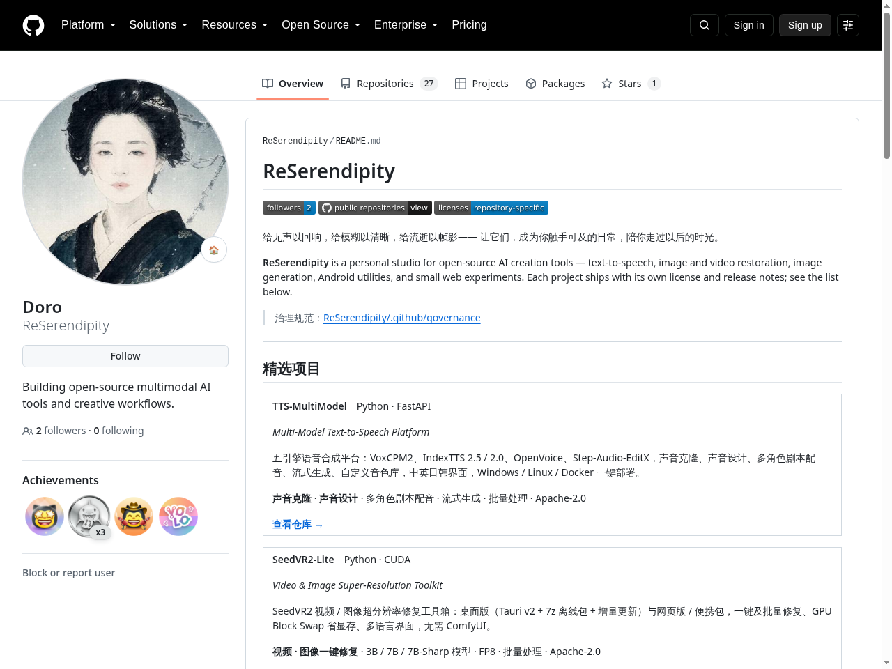
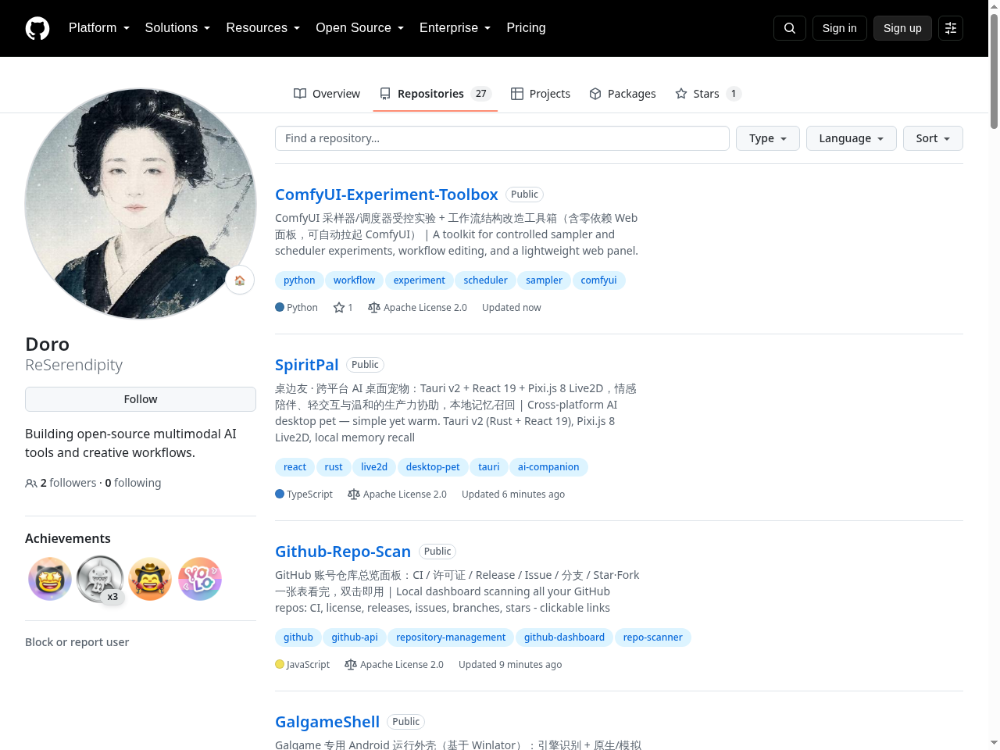
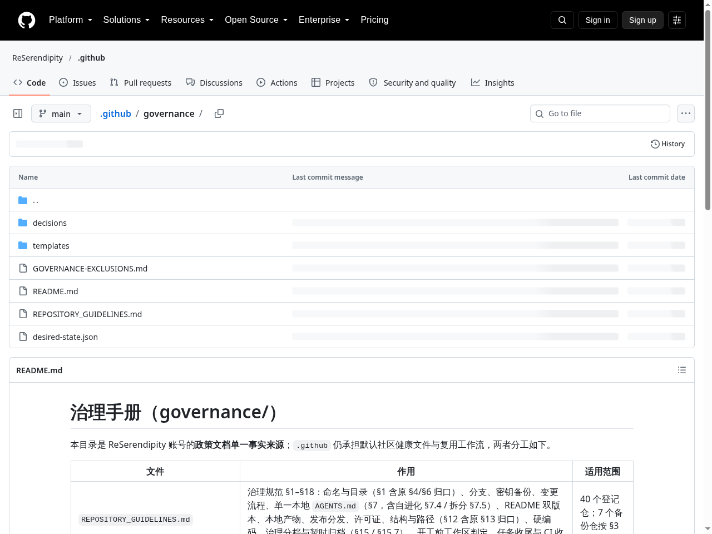
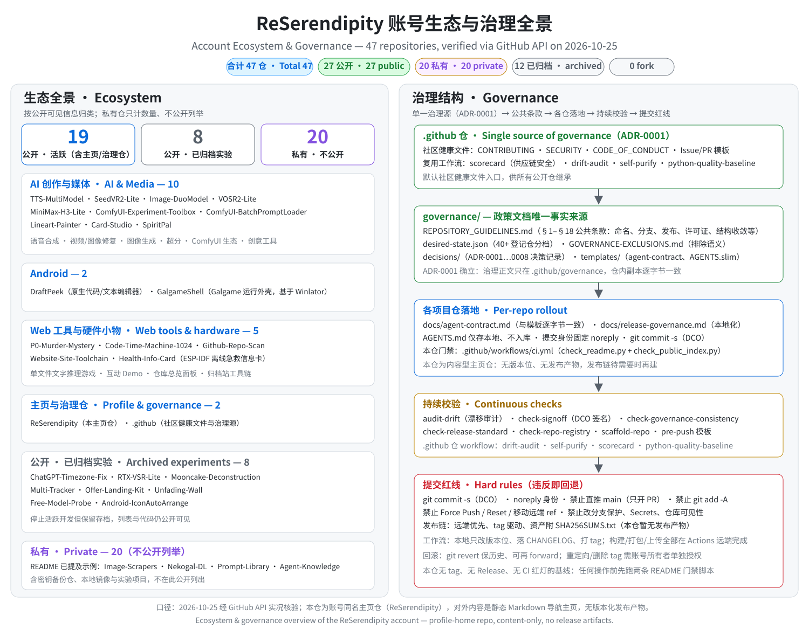

# ReSerendipity

[](https://github.com/ReSerendipity/ReSerendipity/actions/workflows/ci.yml)
[](https://github.com/ReSerendipity/ReSerendipity/commits/main)
[](https://github.com/ReSerendipity?tab=followers)
[](https://github.com/ReSerendipity?tab=repositories)
[](https://github.com/ReSerendipity?tab=repositories)
[](https://github.com/ReSerendipity/ReSerendipity)
[](https://github.com/ReSerendipity/.github/blob/main/CONTRIBUTING.md)
[](https://github.com/ReSerendipity/.github/tree/main/governance)

给无声以回响，给模糊以清晰，给流逝以帧影——
让它们，成为你触手可及的日常，陪你走过以后的时光。

**ReSerendipity** is a personal studio for open-source AI creation tools — text-to-speech, image and video restoration, image generation, Android utilities, and small web experiments. Each project ships with its own license and release notes; see the list below.

> **账号主页 · Account Home**：本仓库是与账号同名的 **GitHub 主页仓**，定位是内容型的**账号主页与仓库导航**——展示账号下的开源项目并沉淀账号级治理规范；本仓自身不构建、不打包、不发布任何可分发产物，安装与发布请进入对应项目仓库。
> This repository is the GitHub **profile home page** of the ReSerendipity account — a content-only showcase and **repository navigation hub**. It builds, packages, and releases nothing itself; installation and release artifacts live in each project's own repository.

[中文](#中文) | [English](#english)

---

## 中文

### 关于本仓（账号主页与仓库导航）

ReSerendipity 是账号同名主页仓，定位为**账号主页与仓库导航**：统一展示账号下的开源项目（AI 创作与媒体、Android 工具、Web 小应用与硬件小物），并沉淀账号级治理规范。本仓不构建、不打包、不发布任何可分发产物——部署与发布请进入对应项目仓库，按其 README 操作。

### 核心特性

1. **一站式项目导航** — 17 个公开活跃项目按领域归类，精选项目卡片直达（TTS-MultiModel、SeedVR2-Lite）
2. **真实运行截图** — 主页、项目导航、治理结构均使用实况截图，所见即所得
3. **生态全景图** — 47 个仓库（27 公开 / 20 私有）的生态分布与治理链路一图纵览
4. **治理单一事实来源** — 规范统一沉淀在 `.github` 仓的 `governance/`（§1–§18 公共条款 + ADR 决策记录）
5. **双语内容** — 中文为主、英文逐段对应，方便国内外读者
6. **CI 门禁** — README 完整性由 `ci.yml` 自动校验（`check_readme.py` / `check_public_index.py`）

### 展示


*主页 · 本主页仓 README 的实况渲染：定位语、徽章行与精选项目卡片。*


*项目导航 · Repositories 页实况：全部公开仓库、描述、语言、许可证与更新时间。*


*治理结构 · `.github` 仓 `governance/` 目录与治理手册：政策文档的单一事实来源。*


*生态图 · 47 仓生态/治理结构图：公开/私有/归档分布、领域分组与治理链路（2026-10-25 经 GitHub API 实况核验）。*

### 快速开始

本仓是导航主页，**无安装步骤**：

1. **浏览**：从下方「精选项目」卡片或「全部公开项目」表格进入感兴趣的项目仓库；
2. **运行**：进入目标仓库后按该仓 README 操作（例如 TTS-MultiModel 支持 Windows / Linux / Docker 一键部署；SeedVR2-Lite 提供桌面版与网页版，见其[文档](https://reserendipity.github.io/SeedVR2-Lite/docs/)）；
3. **验证**（仅维护者）：修改本 README 后，在仓库根目录运行

   ```bash
   python3 .github/scripts/check_readme.py
   python3 .github/scripts/check_public_index.py
   ```

   两条命令全部通过即满足 CI 门禁（后者在 GitHub API 不可达时只告警、不判红）。

### 系统要求与兼容性

- **本仓**：纯 Markdown 主页，无运行时依赖；依赖 GitHub 的 CommonMark 渲染（表格、徽章、SVG 均为 GitHub 标准特性）。
- **各项目仓**：系统要求以其自身 README 为准。示例：SeedVR2-Lite 视频/图像超分需要 NVIDIA GPU（CUDA）；TTS-MultiModel 面向 Windows / Linux，亦支持 Docker 部署；Health-Info-Card 是 ESP-IDF 5.5.3 硬件固件。

### 使用示例

- **读者**：直接浏览「精选项目」卡片与「全部公开项目」表格，点击进入目标仓库即可。
- **维护者**：新增公开项目时——把仓库加入对应表格（行格式 `| [名称](链接) | 简介 |`），本地运行上述两条校验命令，再开 PR。
- **贡献者**：各仓库的 Issue / PR 规则以其自身 README 与 `.github` 仓模板为准。

### FAQ

1. **为什么有些仓库标了「已归档」？** 归档表示停止活跃开发但保留存档（如 ChatGPT-Timezone-Fix、RTX-VSR-Lite 等 8 个公开实验项目），列表与代码仍可见。
2. **为什么没有统一的 LICENSE？** 许可证为仓库级、按项目独立管理；两个精选项目 TTS-MultiModel、SeedVR2-Lite 均为 Apache-2.0，其余以各仓库徽章 / LICENSE 为准。
3. **为什么主页仓没有 Release / tag？** 本仓是内容型主页、无可分发产物，发布链待出现可分发产物时再建（依据 `docs/release-governance.md` 与 `CHANGELOG.md`）。
4. **某些项目为什么看不到？** 私有项目不公开（如 Image-Scrapers、Nekogal-DL、Prompt-Library、Agent-Knowledge），仅账号所有者可见。
5. **如何把项目加入首页？** 修改「全部公开项目」表格并运行上述校验命令验证，然后开 PR；详细规范见 `.github` 仓的 [CONTRIBUTING.md](https://github.com/ReSerendipity/.github/blob/main/CONTRIBUTING.md)。

### 文档与治理

- **本仓内**：`docs/agent-contract.md`（Agent 契约）、`docs/release-governance.md`（发布/回滚规范本地化）、`CHANGELOG.md`、`.mailmap`（提交身份归一）。
- **权威治理源**：ReSerendipity/.github 仓 `governance/`——`REPOSITORY_GUIDELINES.md`（§1–§18 公共条款）、`decisions/`（ADR-0001…0008 决策记录）、`templates/`、`desired-state.json`。
- **门禁**：本仓 `ci.yml` 校验 README 存在性、精选卡片内容、许可表述与公开项目索引完整性。

### 精选项目

<!-- 卡片 1 · TTS-MultiModel -->
<table width="100%" cellspacing="0" cellpadding="0"><tr><td style="background:#ffffff;border:1px solid #d0d7de;border-radius:12px;padding:18px 22px;">
<p style="margin:0 0 2px;"><b style="font-size:17px;">TTS-MultiModel</b>　<span style="color:#57606a;">Python · FastAPI</span></p>
<p style="margin:0 0 10px;color:#57606a;"><i>Multi-Model Text-to-Speech Platform</i></p>
<p style="margin:0 0 10px;">五引擎语音合成平台：VoxCPM2、IndexTTS 2.5 / 2.0、OpenVoice、Step-Audio-EditX，声音克隆、声音设计、多角色剧本配音、流式生成、自定义音色库，中英日韩界面，Windows / Linux / Docker 一键部署。</p>
<p style="margin:0 0 12px;color:#0969da;"><b>声音克隆</b> · <b>声音设计</b> · 多角色剧本配音 · 流式生成 · 批量处理 · Apache-2.0</p>
<p style="margin:0;"><a href="https://github.com/ReSerendipity/TTS-MultiModel"><b>查看仓库 →</b></a></p>
</td></tr></table>

<!-- 卡片 2 · SeedVR2-Lite -->
<table width="100%" cellspacing="0" cellpadding="0"><tr><td style="background:#ffffff;border:1px solid #d0d7de;border-radius:12px;padding:18px 22px;">
<p style="margin:0 0 2px;"><b style="font-size:17px;">SeedVR2-Lite</b>　<span style="color:#57606a;">Python · CUDA</span></p>
<p style="margin:0 0 10px;color:#57606a;"><i>Video &amp; Image Super-Resolution Toolkit</i></p>
<p style="margin:0 0 10px;">SeedVR2 视频 / 图像超分辨率修复工具箱：桌面版（Tauri v2 + 7z 离线包 + 增量更新）与网页版 / 便携包，一键及批量修复、GPU Block Swap 省显存、多语言界面，无需 ComfyUI。</p>
<p style="margin:0 0 12px;color:#0969da;"><b>视频 · 图像一键修复</b> · 3B / 7B / 7B-Sharp 模型 · FP8 · 批量处理 · Apache-2.0</p>
<p style="margin:0;"><a href="https://github.com/ReSerendipity/SeedVR2-Lite"><b>查看仓库 →</b></a> · <a href="https://reserendipity.github.io/SeedVR2-Lite/docs/"><b>文档</b></a></p>
</td></tr></table>

### 全部公开项目

#### AI 创作与媒体

| 项目 | 简介 |
|---|---|
| [Image-DuoModel](https://github.com/ReSerendipity/Image-DuoModel) | 多模型 AI 图像生成平台：进程内原生引擎接入 Z-Image Turbo / Qwen-Image 2.1 Edit / Flux.2 Klein，LoRA 叠加、SeedVR2 超分、批量生成、DCT 水印溯源 |
| [VOSR2-Lite](https://github.com/ReSerendipity/VOSR2-Lite) | Standalone VOSR2 diffusion 图像超分工具箱（FastAPI + Web UI，无需 ComfyUI） |
| [MiniMax-H3-Lite](https://github.com/ReSerendipity/MiniMax-H3-Lite) | MiniMax H3 本地视频生成时间线工作台：T2V/I2V/R2V 三模式、多镜头编排，一键启动 / Docker |
| [ComfyUI-Experiment-Toolbox](https://github.com/ReSerendipity/ComfyUI-Experiment-Toolbox) | ComfyUI 采样器/调度器受控实验 + 工作流结构改造工具箱（含零依赖 Web 面板） |
| [ComfyUI-BatchPromptLoader](https://github.com/ReSerendipity/ComfyUI-BatchPromptLoader) | ComfyUI 自定义节点：从 TXT 批量加载/编码 Prompt，支持固定/递增/递减/随机模式 |
| [Lineart-Painter](https://github.com/ReSerendipity/Lineart-Painter) | 本地 AI 线稿重绘工作台：图片/视频转线稿并分阶段上色 |
| [Card-Studio](https://github.com/ReSerendipity/Card-Studio) | 浏览器端多视图 3D 全息卡片生成器（本地 ONNX 抠图） |
| [SpiritPal](https://github.com/ReSerendipity/SpiritPal) | 桌边友 · 跨平台 AI 桌面宠物（Tauri v2 + Live2D，本地记忆召回） |

#### Android

| 项目 | 简介 |
|---|---|
| [DraftPeek](https://github.com/ReSerendipity/DraftPeek) | Android 原生代码/文本编辑器：内置终端、Markdown 预览、40+ 语言高亮 |
| [GalgameShell](https://github.com/ReSerendipity/GalgameShell) | Galgame 专用 Android 运行外壳（基于 Winlator）：引擎识别 + 原生 / 模拟智能路由，导入即玩 |

#### Web 工具与硬件小物

| 项目 | 简介 |
|---|---|
| [P0-Murder-Mystery](https://github.com/ReSerendipity/P0-Murder-Mystery) | P0 事故剧本杀：AI Agent、线索、限时与多结局的单文件文字推理游戏 |
| [Code-Time-Machine-1024](https://github.com/ReSerendipity/Code-Time-Machine-1024) | 代码时间机器：从打孔纸带到 AI 编程，六个时代的零构建单文件互动 Demo |
| [Github-Repo-Scan](https://github.com/ReSerendipity/Github-Repo-Scan) | GitHub 账号仓库总览面板：CI / 许可证 / Release / Issue / Star 一张表 |
| [Website-Site-Toolchain](https://github.com/ReSerendipity/Website-Site-Toolchain) | 四个角色文本归档站的结构签名门禁工具链：只校验 frontmatter / 路径 / 编号 |
| [Health-Info-Card](https://github.com/ReSerendipity/Health-Info-Card) | 老人安心牌：离线急救信息卡（ESP-IDF） |

> 治理与社区健康文件（命名规范、贡献指南、Issue 模板）见 [.github](https://github.com/ReSerendipity/.github) 仓库。
> 另有若干私有项目（Image-Scrapers、Nekogal-DL、Prompt-Library、Agent-Knowledge 等）不在此列。

### 贡献 / 安全 / 支持

- **贡献**：请遵循 `.github` 仓的 [CONTRIBUTING.md](https://github.com/ReSerendipity/.github/blob/main/CONTRIBUTING.md)；本主页仓的一切改动走 PR（欢迎 PRs）。
- **安全**：发现安全漏洞请按 [SECURITY.md](https://github.com/ReSerendipity/.github/blob/main/SECURITY.md) 私下报告，勿在公开渠道讨论。
- **支持**：项目相关的问题请到对应仓库开 Issue / Discussion；本仓相关问题（导航、治理）可在本仓 Issues 提出。

### 许可证

本仓 README 内容未单独设立 LICENSE；**许可证为仓库级、按项目独立管理**。精选项目 TTS-MultiModel 与 SeedVR2-Lite 均为 Apache-2.0，其余以各仓库徽章 / LICENSE 为准。

---

## English

### About (Account Home & Repository Navigation)

ReSerendipity is the GitHub **profile home page** of the ReSerendipity account — a content-only showcase and **repository navigation hub**. It presents the account's open-source projects (AI media tools, Android utilities, web experiments and hobby hardware) and hosts account-level governance documents. This repository builds, packages, or releases nothing itself: for installation and release artifacts, open the corresponding project repository and follow its README.

### Key Features

1. **One-stop project navigation** — 17 active public projects grouped by domain, with featured cards (TTS-MultiModel, SeedVR2-Lite) on top
2. **Real screenshots** — home page, repository navigation and governance structure shown as live captures
3. **Ecosystem overview** — a 47-repo ecosystem & governance diagram (27 public / 20 private)
4. **Single source of governance** — policy lives in the `.github` repo's `governance/` (rules §1–§18 + ADR decision records)
5. **Bilingual content** — Chinese first, with a full English mirror
6. **CI gate** — README integrity is enforced by `ci.yml` (`check_readme.py` / `check_public_index.py`)

### Gallery


*Profile home · live rendering of this repo's README: tagline, badge rows and featured project cards.*


*Repository navigation · live Repositories tab: public repos, descriptions, languages, licenses and update times.*


*Governance · `.github` repo `governance/` directory and handbook: single source of policy.*


*Ecosystem · 47-repo ecosystem/governance diagram: public/private/archived split, domain groups and governance chain (verified via GitHub API on 2026-10-25).*

### Quick Start

This is a navigation page — **there is nothing to install**:

1. **Browse**: pick a project from the featured cards or the All Public Projects list below;
2. **Run**: open the project repo and follow its own README (e.g. TTS-MultiModel ships one-click deploy for Windows / Linux / Docker; SeedVR2-Lite offers a desktop build and a web/portable build — see its [docs](https://reserendipity.github.io/SeedVR2-Lite/docs/));
3. **Verify** (maintainers only): after editing this README, run from the repository root

   ```bash
   python3 .github/scripts/check_readme.py
   python3 .github/scripts/check_public_index.py
   ```

   Both green means the CI gate passes (the latter only warns, not fails, when the GitHub API is unreachable).

### System Requirements & Compatibility

- **This repo**: a plain-Markdown page with no runtime dependencies; it relies on GitHub's CommonMark rendering (tables, badges and SVG are standard GitHub features).
- **Project repos**: see each repo's own README. Examples: SeedVR2-Lite video/image super-resolution needs an NVIDIA GPU (CUDA); TTS-MultiModel targets Windows / Linux and supports Docker; Health-Info-Card is ESP-IDF 5.5.3 firmware.

### Usage Examples

- **Readers**: browse the featured cards and the All Public Projects tables, then click through to any project repo.
- **Maintainers**: when adding a public project — insert a row (`| [name](link) | summary |`) in the matching table, run the two check scripts locally, then open a PR.
- **Contributors**: each repo's Issue / PR rules are defined in its own README and the `.github` templates.

### FAQ

1. **Why are some repositories archived?** Archived means development is frozen but the work stays visible (e.g. 8 public experiments such as ChatGPT-Timezone-Fix and RTX-VSR-Lite).
2. **Why is there no single LICENSE?** Licenses are managed per repository; both featured projects (TTS-MultiModel, SeedVR2-Lite) are Apache-2.0, others carry their own repository badges / LICENSE files.
3. **Why does this home repo have no Release / tag?** It is a content-only page with no distributable artifacts; a release chain will be added only if such artifacts appear (see `docs/release-governance.md` and `CHANGELOG.md`).
4. **Why can't I see some projects?** Private projects (e.g. Image-Scrapers, Nekogal-DL, Prompt-Library, Agent-Knowledge) are visible to the account owner only.
5. **How do I get a project listed here?** Add a row to the All Public Projects tables, run the checks above, and open a PR; see [CONTRIBUTING.md](https://github.com/ReSerendipity/.github/blob/main/CONTRIBUTING.md) in the `.github` repo for the full rules.

### Documentation & Governance

- **In this repo**: `docs/agent-contract.md` (agent contract), `docs/release-governance.md` (localized release/rollback rules), `CHANGELOG.md`, `.mailmap` (commit identity normalization).
- **Authoritative source**: `governance/` in the ReSerendipity/.github repo — `REPOSITORY_GUIDELINES.md` (§1–§18), `decisions/` (ADR-0001…0008), `templates/`, `desired-state.json`.
- **Gate**: this repo's `ci.yml` validates README existence, featured-card content, license statements and full public-project index coverage.

### Featured Projects

The two featured cards are shown in the Chinese section above ([jump](#精选项目)). Shortlist:

- [TTS-MultiModel](https://github.com/ReSerendipity/TTS-MultiModel) — five-engine TTS platform: VoxCPM2, IndexTTS 2.5 / 2.0, OpenVoice, Step-Audio-EditX; voice cloning, voice design, script dubbing, streaming; UI in Chinese / English / Japanese / Korean; Apache-2.0.
- [SeedVR2-Lite](https://github.com/ReSerendipity/SeedVR2-Lite) — video & image super-resolution toolkit: desktop (Tauri v2 + 7z offline package + incremental updates) and web/portable builds; 3B / 7B / 7B-Sharp, FP8, GPU Block Swap; no ComfyUI; Apache-2.0. Docs: <https://reserendipity.github.io/SeedVR2-Lite/docs/>.

### All Public Projects

- **AI & media** (8): [Image-DuoModel](https://github.com/ReSerendipity/Image-DuoModel), [VOSR2-Lite](https://github.com/ReSerendipity/VOSR2-Lite), [MiniMax-H3-Lite](https://github.com/ReSerendipity/MiniMax-H3-Lite), [ComfyUI-Experiment-Toolbox](https://github.com/ReSerendipity/ComfyUI-Experiment-Toolbox), [ComfyUI-BatchPromptLoader](https://github.com/ReSerendipity/ComfyUI-BatchPromptLoader), [Lineart-Painter](https://github.com/ReSerendipity/Lineart-Painter), [Card-Studio](https://github.com/ReSerendipity/Card-Studio), [SpiritPal](https://github.com/ReSerendipity/SpiritPal)
- **Android** (2): [DraftPeek](https://github.com/ReSerendipity/DraftPeek), [GalgameShell](https://github.com/ReSerendipity/GalgameShell)
- **Web tools & hardware** (5): [P0-Murder-Mystery](https://github.com/ReSerendipity/P0-Murder-Mystery), [Code-Time-Machine-1024](https://github.com/ReSerendipity/Code-Time-Machine-1024), [Github-Repo-Scan](https://github.com/ReSerendipity/Github-Repo-Scan), [Website-Site-Toolchain](https://github.com/ReSerendipity/Website-Site-Toolchain), [Health-Info-Card](https://github.com/ReSerendipity/Health-Info-Card)
- Plus the two featured projects above — **17 active public projects in total**.

> Community & governance files live in the [.github](https://github.com/ReSerendipity/.github) repo. Some projects (Image-Scrapers, Nekogal-DL, Prompt-Library, Agent-Knowledge, …) are private and not listed here.

### Contributing / Security / Support

- **Contributing**: follow [CONTRIBUTING.md](https://github.com/ReSerendipity/.github/blob/main/CONTRIBUTING.md) in the `.github` repo; all changes to this home page go through PRs (PRs welcome).
- **Security**: report vulnerabilities privately per [SECURITY.md](https://github.com/ReSerendipity/.github/blob/main/SECURITY.md); do not discuss them in public channels.
- **Support**: open Issues / Discussions in the relevant project repo; for this home page (navigation, governance), use this repo's Issues.

### License

The README content of this repository carries no standalone LICENSE; **licenses are per-project**. Both featured projects (TTS-MultiModel, SeedVR2-Lite) are Apache-2.0; others carry their own repository badges / LICENSE files.
